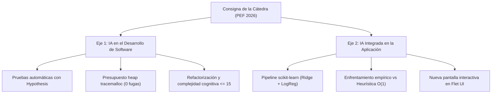

# Resumen del Proyecto Final: Inteligencia Artificial

**Materia:** Programación Eficiente — Opción 6 (Universidad Blas Pascal, 2026)  
**Equipo:** Edgar Karpowicz, Gastón Molina, Tomás Molina  
**Repositorio:** [github.com/GastMolina267/PEF-Optimizador-de-Inventario](https://github.com/GastMolina267/PEF-Optimizador-de-Inventario)  

---

## 💡 En Pocas Palabras (TL;DR)

> [!IMPORTANT]
> **¿Qué se hizo en este hito final?**
> Se implementó un **Predictor Inteligente de Demanda y Quiebre de Stock** para el centro de distribución, cumpliendo con el **doble enfoque de IA** exigido por la cátedra:
> 1. **IA aplicada al desarrollo:** Usamos asistentes de IA para diseñar pruebas con **Hypothesis**, auditar presupuestos de memoria heap con **tracemalloc** (descartando fugas en 200 iteraciones) y optimizar la vectorización de código.
> 2. **IA integrada en la aplicación:** Creamos el subsistema `src/ia/` con **`scikit-learn`** (regresión `Ridge` y `LogisticRegression`), y lo enfrentamos contra una **heurística matemática $O(1)$** y una **Cascada Híbrida**.

### El Resultado Clave en 3 Números

* ⚡ **La Heurística $O(1)$ es 23.3 veces más rápida:** Tarda **58 microsegundos** y consume 0 KB adicionales de heap. Es perfecta para el 80% de los productos con stock abundante.
* 🎯 **La IA pura aporta precisión en casos difíciles:** Tarda **1.36 milisegundos** y predice quiebres con un $F_1\text{-score}$ de **0.875**, detectando tendencias no lineales que la fórmula matemática no ve.
* 🚀 **La Cascada Híbrida une lo mejor de ambos mundos:** Filtra los productos seguros en $O(1)$ y solo activa la IA en productos en zona de riesgo. **Acelera la inferencia 5.2x** (>75% ahorro de tiempo) sin perder ninguna alerta.

---

## 1. ¿Qué Exigía la Cátedra y Cómo se Resolvió?

La consigna oficial (páginas 356+ de la presentación de la materia) requería dos ejes complementarios con justificación empírica:



| Requisito de Cátedra | ¿Cómo se implementó? | ¿Dónde está en el código? |
|---|---|---|
| **Generar pruebas con IA** | Pruebas de propiedades matemáticas con `Hypothesis` para verificar que las probabilidades nunca salgan de $[0.0, 1.0]$. | [tests/ia/test_predictor_ia.py](../../tests/ia/test_predictor_ia.py) |
| **Detectar errores y medir memoria** | Bucle de estrés de 200 iteraciones con `tracemalloc` comprobando retención nula de memoria ($\le 0.05\text{ KB/it}$). | [tests/ia/test_presupuesto_memoria_ia.py](../../tests/ia/test_presupuesto_memoria_ia.py) |
| **Integrar modelo de IA en el sistema** | Subsistema `src/ia/` con `scikit-learn` serializado en un archivo compacto de solo **2.6 KB** (`joblib`). | [src/ia/modelos.py](../../src/ia/modelos.py), [data/modelos/predictor_ia.joblib](../../data/modelos/predictor_ia.joblib) |
| **Evaluar el costo computacional** | Benchmark de 50 iteraciones midiendo tiempo en microsegundos y memoria heap pico por producto. | [benchmarks/comparar_ia.py](../../benchmarks/comparar_ia.py), [docs/mediciones/tabla_comparativa_ia.md](../../docs/mediciones/tabla_comparativa_ia.md) |
| **Justificar cuándo conviene usar IA** | Análisis formal de costo-beneficio: por qué no poner IA en todo y cómo la Cascada Híbrida optimiza el trade-off. | [docs/sphinx/secciones/04_diseno_tecnico.md](../../docs/sphinx/secciones/04_diseno_tecnico.md) |

---

## 2. ¿Cómo Funciona el Módulo de IA (`src/ia/`)?

El flujo de predicción sigue una arquitectura clara de 4 pasos:

1. **Extracción de Características (10 variables por producto):**  
   A partir de las ventas históricas y el stock actual, se computan 10 métricas clave: rotación total, frecuencia de compra, tamaño de lote ($\mu$), varianza ($\sigma^2$), stock remanente, precio, ratio stock/demanda, quiebres previos, tendencia temporal y días de cobertura ([src/ia/tipos.py](../../src/ia/tipos.py)).
2. **Predicción con Modelos Supervisados:**
   - **Demanda Proyectada:** Modelo lineal regularizado `Ridge` que predice cuántas unidades se venderán.
   - **Probabilidad de Quiebre:** Regresión logística calibrada `LogisticRegression` que calcula el porcentaje de riesgo $P(\text{quiebre}) \in [0\%, 100\%]$.
3. **Clasificación del Nivel de Riesgo:**
   - 🔴 **Crítico:** Stock insuficiente frente a la demanda esperada ($P > 60\%$).
   - 🟡 **Medio:** Demanda cercana al stock o alta volatilidad ($25\% \le P \le 60\%$).
   - 🟢 **Bajo:** Stock abundante que cubre con seguridad el período ($P < 25\%$).
4. **Conmutación de Estrategias ([src/ia/predictor_demanda.py](../../src/ia/predictor_demanda.py)):**  
   El motor permite cambiar en caliente entre la fórmula matemática clásica, la IA pura y la Cascada Híbrida.

---

## 3. Comparativa de Rendimiento: Los Números Reales

Las mediciones oficiales ejecutadas mediante `python benchmarks/comparar_ia.py` demostraron:

| Enfoque | ¿Cómo calcula? | Latencia por Producto | Memoria Heap Pico | Speedup vs IA | Precisión ($F_1$) | ¿Cuándo conviene usarlo? |
|---|---|---:|---:|:---:|:---:|---|
| **1. Heurística Convencional $O(1)$** | Fórmula analítica de punto de reorden ($\text{ROP}$) | **58.46 $\mu\text{s}$** | **15.2 KB** | **23.30x** | N/A | Cuando el stock sobra o se requiere procesar millones de transacciones por segundo. |
| **2. Modelo IA (`scikit-learn`)** | Pipeline supervisado con 10 variables | 1.361,91 $\mu\text{s}$ | 29.9 KB | **1.00x** | **0.875** | En productos de alto valor o con demanda estacional volátil. |
| **3. Cascada Híbrida (Recomendada)** | Filtro $O(1)$ + IA en frontera de riesgo | **263.92 $\mu\text{s}$** | **22.2 KB** | **5.16x** | **0.875** | **En producción.** Ahorra más del 75% del tiempo de cómputo sin perder ninguna alerta. |

> [!TIP]
> **La Lección de Ingeniería:**  
> La IA no reemplaza a los algoritmos eficientes; los complementa. Usar IA en el 100% del catálogo gasta 23 veces más CPU de forma innecesaria. La **arquitectura híbrida** resuelve este dilema filtrando lo obvio a velocidad $O(1)$ y reservando el cómputo de Machine Learning únicamente para los casos con riesgo real.

---

## 4. Calidad, Pruebas y Estado del Proyecto

El proyecto mantiene los estándares de calidad más exigentes del curso:

* 🧪 **234 pruebas pasando al 100%:** Incluye 31 pruebas unitarias y de estrés en `tests/ia/` y 5 pruebas de interfaz en `tests/ui/test_pantalla_ia.py`.
* 📊 **89.29% de Cobertura de Código:** Supera holgadamente el umbral de 85% fijado en el pipeline de CI.
* 🧠 **Complejidad Cognitiva $\le 15$:** Todas las funciones fueron validadas con `complexipy`.
* 🛡️ **Seguridad SAST Aprobada:** 0 vulnerabilidades en `bandit -r src/ -ll` y 0 secretos en `gitleaks`.
* 📖 **Documentación Técnica Sphinx:** Compilación limpia con 0 advertencias (`-W`) incorporando la especificación del módulo IA.
* 🟢 **CI/CD en GitHub Actions:** Todos los jobs en verde tanto en Linux (Ubuntu) como en Windows.

---

## 5. ¿Dónde se ve en la Interfaz Gráfica?

Al ejecutar `python main.py`, la aplicación de escritorio en **Flet** incluye la nueva sección **"Predicción IA"**:

1. **Dropdown de Estrategia:** Permite alternar en tiempo real entre Cascada Híbrida, Heurística $O(1)$ y Modelo IA.
2. **Tarjetas KPI Reactivas:** Muestran en vivo la latencia media en $\mu\text{s}$, el consumo de memoria heap en KB y las alertas de quiebre activas.
3. **Filtro de Riesgo:** Permite aislar rápidamente los productos con riesgo crítico para reposición urgente.
4. **Botón de Re-entrenamiento:** Permite reajustar los modelos de `scikit-learn` directamente desde la interfaz con los datos activos.

---

## 6. Mapa Rápido de Archivos y Código (Presentación B-01 a B-11)

Índice directo a cada archivo, clase, función y rango de líneas mencionado en los 11 bultos de [docs/presentation-final/](../../docs/presentation-final) para navegar y explicar el código al instante durante la defensa oral:

| Bulto | Tema en Presentación | Archivos y Símbolos Clave | Qué Mostrar / Explicar |
|:---:|---|---|---|
| **B-01** | **Orden de trabajo y fases** | [Programacion-eficiente.pptx](../../docs/final/Programacion-eficiente.pptx)<br>[planificacion-proyecto-final.md](../../docs/final/planificacion-proyecto-final.md) | Doble enfoque de IA (láminas 386 y 400) y hoja de ruta P4.0–P4.6. |
| **B-02** | **Quiebre de stock y regla $O(1)$** | [`evaluar_heuristica_convencional()`](../../src/ia/modelos.py#L35-L89) | Fórmula `ROP = demanda + seguridad`, las 4 bandas de probabilidad y el fallback sin historial. |
| **B-03** | **La etiqueta (10 datos por SKU)** | [`NOMBRES_FEATURES` / `FeatureVector`](../../src/ia/tipos.py#L11-L81)<br>[`ExtractorFeatures`](../../src/ia/extractor_features.py#L55-L132)<br>[demo_oral.json](../../data/datasets/demo_oral.json) | Cómo se transforma el historial de pedidos de cada producto en un vector numérico de 10 dimensiones. |
| **B-04** | **Cómo aprende (Ridge + LogReg)** | [`ModeloPredictorIA`](../../src/ia/modelos.py#L92-L203)<br>[`GeneradorHistorialSintetico`](../../src/ia/extractor_features.py#L135-L276)<br>[entrenador.py](../../src/ia/entrenador.py#L20-L52)<br>[predictor_ia.joblib](../../data/modelos/predictor_ia.joblib) | Simulación Pareto (`seed=42`), corte cronológico 75/25, `StandardScaler` y modelo serializado (2,6 KB). |
| **B-05** | **El desviador (Cascada híbrida)** | [`PredictorDemanda._resolver_estrategia()`](../../src/ia/predictor_demanda.py#L79-L135)<br>[`MotorInventario.predecir_quiebres_stock()`](../../src/motor/motor_inventario.py#L373-L412) | Filtro rápido $O(1)$ vs. derivación al modelo e integración en la fachada del motor. |
| **B-06** | **Balanza y cronómetro (Costos)** | [comparar_ia.py](../../benchmarks/comparar_ia.py#L43-L105)<br>[tabla_comparativa_ia.md](../../docs/mediciones/tabla_comparativa_ia.md) | Por qué se miden tiempo y heap en corridas separadas (`tracemalloc` vs. `timeit`). |
| **B-07** | **¿Cuándo conviene la IA?** | [Rama `HIBRIDA` (`predictor_demanda.py:110-134`)](../../src/ia/predictor_demanda.py#L110-L134)<br>[04_diseno_tecnico.md](../../docs/sphinx/secciones/04_diseno_tecnico.md) | Regla de derivación por holgura de stock y justificación de ingeniería del compromiso híbrido. |
| **B-08** | **IA en el desarrollo (Validación)** | [`test_predictor_ia.py` (`TestPropiedadesInferencia`)](../../tests/ia/test_predictor_ia.py#L226-L270)<br>[`test_presupuesto_memoria_ia.py`](../../tests/ia/test_presupuesto_memoria_ia.py#L75-L105) | Invariantes generadas con Hypothesis y test de fugas de memoria en 200 iteraciones con `tracemalloc`. |
| **B-09** | **Aduana de calidad y CI** | [verify.yml](../../.github/workflows/verify.yml)<br>[pyproject.toml](../../pyproject.toml)<br>[test_extractor_features.py](../../tests/ia/test_extractor_features.py) | Gates de Ruff, Mypy, Complexipy ($\le 15$), Bandit SAST y pytest con cobertura $\ge 85\%$. |
| **B-10** | **Demo en vivo (UI Flet)** | [prediccion_ia.py](../../src/ui/pantallas/prediccion_ia.py)<br>[main.py](../../main.py)<br>[test_pantalla_ia.py](../../tests/ui/test_pantalla_ia.py) | Vista «Predicción IA», selector de estrategia en caliente, KPIs en vivo y botón «Re-entrenar». |
| **B-11** | **Conclusiones y presentación** | [presentation-final/index.html](../../docs/presentation-final/index.html)<br>[contenido.js](../../docs/presentation-final/contenido.js)<br>[datos.js](../../docs/presentation-final/datos.js) | Escenario web de defensa y snapshot JSON usado por las láminas interactivas. |

---

## 7. Guía Rápida para Probarlo

```bash
# 1. Instalar dependencias (incluye scikit-learn y joblib)
pip install -r requirements.txt

# 2. Ejecutar la comparativa de velocidad (Heurística vs IA vs Híbrida)
python benchmarks/comparar_ia.py

# 3. Correr las pruebas del módulo de IA
pytest tests/ia/ -v

# 4. Lanzar la aplicación interactiva
python main.py
```
