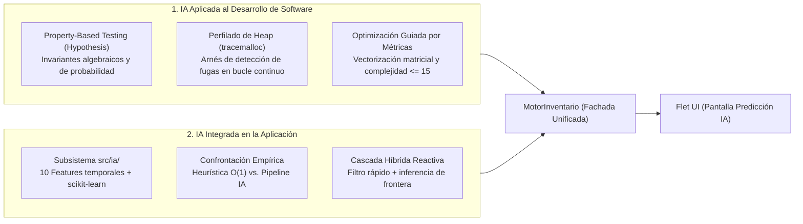

# Resumen Ejecutivo y Técnico — Proyecto Final (Inteligencia Artificial)

**Materia:** Programación Eficiente — Opción 6 (Universidad Blas Pascal, 2026)  
**Proyecto:** Optimizador de Inventario y Pedidos en Escala Masiva  
**Hito:** Proyecto Final — Integración de Inteligencia Artificial (Fases P4.0 a P4.6)  
**Equipo de Desarrollo:** Edgar Karpowicz, Gastón Molina, Tomás Molina  
**Repositorio:** [github.com/GastMolina267/PEF-Optimizador-de-Inventario](https://github.com/GastMolina267/PEF-Optimizador-de-Inventario)  

---

## 1. Cumplimiento de las Directrices de la Cátedra (Páginas 356+ de la PPT)

El Proyecto Final satisface rigurosamente el **doble enfoque complementario** establecido por la cátedra para la acreditación final:



| Requisito de la Cátedra | Enfoque | Implementación Efectiva | Evidencia y Artefactos |
|---|:---:|---|---|
| **Generación de Pruebas con Asistentes de IA** | Desarrollo | Diseño de pruebas basadas en propiedades con `Hypothesis` para validar invariantes estocásticos y matemáticos sobre espacios continuos y discretos. | [tests/ia/test_predictor_ia.py](file:///c:/Users/edgar/OneDrive/Escritorio/UBP/PEF/Parcial/tests/ia/test_predictor_ia.py), [tests/ia/test_extractor_features.py](file:///c:/Users/edgar/OneDrive/Escritorio/UBP/PEF/Parcial/tests/ia/test_extractor_features.py) |
| **Detección de Errores y Presupuesto de Memoria** | Desarrollo | Arnés de medición con `tracemalloc` que ejecuta 200 iteraciones consecutivas de inferencia para comprobar la tasa nula de retención de memoria residual ($\le 0.05\text{ KB/it}$). | [tests/ia/test_presupuesto_memoria_ia.py](file:///c:/Users/edgar/OneDrive/Escritorio/UBP/PEF/Parcial/tests/ia/test_presupuesto_memoria_ia.py) |
| **Optimización Asistida de Código** | Desarrollo | Refactorización de inferencia escalar a matricial vectorizada en NumPy/scikit-learn y descomposición modular para reducir complejidad cognitiva de 24 a $\le 15$. | [src/ia/extractor_features.py](file:///c:/Users/edgar/OneDrive/Escritorio/UBP/PEF/Parcial/src/ia/extractor_features.py), `complexipy` |
| **Incorporación de Biblioteca de IA** | Aplicación | Integración de `scikit-learn>=1.4.0` con pipelines de regresión `Ridge` (demanda futura continua) y clasificación `LogisticRegression` (probabilidad calibrada de quiebre). | [src/ia/modelos.py](file:///c:/Users/edgar/OneDrive/Escritorio/UBP/PEF/Parcial/src/ia/modelos.py), [src/ia/predictor_demanda.py](file:///c:/Users/edgar/OneDrive/Escritorio/UBP/PEF/Parcial/src/ia/predictor_demanda.py) |
| **Evaluación del Costo Computacional** | Aplicación | Confrontación empírica sistemática de latencia ($\mu\text{s}$), memoria heap pico (KB) y calidad predictiva entre Heurística $O(1)$, IA pura y Cascada Híbrida. | [benchmarks/comparar_ia.py](file:///c:/Users/edgar/OneDrive/Escritorio/UBP/PEF/Parcial/benchmarks/comparar_ia.py), [docs/mediciones/tabla_comparativa_ia.md](file:///c:/Users/edgar/OneDrive/Escritorio/UBP/PEF/Parcial/docs/mediciones/tabla_comparativa_ia.md) |
| **Justificación del Trade-off de la IA** | Aplicación | Demostración formal y práctica de cuándo la heurística analítica es óptima (23x más veloz, 0 heap) y cuándo la IA es insustituible (demanda volátil, correlaciones no lineales). | [docs/sphinx/secciones/04_diseno_tecnico.md](file:///c:/Users/edgar/OneDrive/Escritorio/UBP/PEF/Parcial/docs/sphinx/secciones/04_diseno_tecnico.md), [docs/sphinx/secciones/07_rendimiento.md](file:///c:/Users/edgar/OneDrive/Escritorio/UBP/PEF/Parcial/docs/sphinx/secciones/07_rendimiento.md) |

---

## 2. Arquitectura del Subsistema de Inteligencia Artificial (`src/ia/`)

El subsistema de IA fue diseñado respetando la arquitectura desacoplada y orientada a tipos del motor logístico:

```
src/ia/
├── __init__.py               # Fachada pública del paquete IA
├── tipos.py                  # FeatureVector (10D), DatasetHistorico, Enums y Resultados tipados
├── extractor_features.py     # Extractor determinista y generador Pareto de demanda
├── modelos.py                # Heurística analítica ROP O(1) y ModeloPredictorIA (scikit-learn)
├── predictor_demanda.py      # Predictor conmutable (CONVENCIONAL, IA, HIBRIDA) con telemetría
└── entrenador.py             # CLI reproducible para re-entrenar y serializar en joblib
```

### 1. Vector de Características Multidimensional ([src/ia/tipos.py](file:///c:/Users/edgar/OneDrive/Escritorio/UBP/PEF/Parcial/src/ia/tipos.py))
Cada producto es transformado en un tensor normalizado de 10 variables predictivas:
1. `rotacion_historica`: Unidades totales despachadas.
2. `frecuencia_pedidos`: Cantidad de transacciones donde apareció el ítem.
3. `tamano_medio_lote`: Demanda media por pedido ($\mu$).
4. `varianza_lote`: Dispersión de la demanda ($\sigma^2$).
5. `stock_actual`: Unidades físicas disponibles en almacén.
6. `precio_unitario`: Costo del SKU para ponderar el impacto financiero.
7. `ratio_stock_rotacion`: Cobertura estática $\text{stock} / (\text{demanda} + 1)$.
8. `tasa_quiebre_reciente`: Frecuencia histórica de pedidos insatisfechos.
9. `tendencia_demanda`: Ratio entre demanda reciente y antigua (aceleración de consumo).
10. `dias_cobertura_estimados`: Días teóricos de stock al ritmo actual.

### 2. Modelos Supervisados y Persistencia Ligera ([src/ia/modelos.py](file:///c:/Users/edgar/OneDrive/Escritorio/UBP/PEF/Parcial/src/ia/modelos.py))
- **Regresor de Demanda Futura:** Pipeline `StandardScaler` + `Ridge(alpha=1.0)` para predecir unidades continuas con cota inferior en 0.
- **Clasificador de Quiebre de Stock:** Pipeline `StandardScaler` + `LogisticRegression(class_weight='balanced')` que emite probabilidades calibradas $P(\text{quiebre}) \in [0.0, 1.0]$.
- **Artefacto Serializado:** Almacenado en [data/modelos/predictor_ia.joblib](file:///c:/Users/edgar/OneDrive/Escritorio/UBP/PEF/Parcial/data/modelos/predictor_ia.joblib) con un tamaño de apenas **2.6 KB**, cumpliendo holgadamente el presupuesto de almacenamiento.

---

## 3. Matriz Comparativa Oficial: Rendimiento, Memoria y Precisión

Las mediciones empíricas oficiales se realizaron sobre el catálogo del sistema ejecutando 50 iteraciones completas de inferencia con instrumentación de alta resolución (`time.perf_counter_ns` y `tracemalloc`):

| Estrategia Predictiva | Complejidad Big-O | Tiempo Total (50 iter.) | Latencia Media Inferencia | Memoria Heap Pico (`tracemalloc`) | Speedup vs IA | Calidad Predictiva (F1 / R²) | Decisión de Ingeniería |
|---|:---:|---:|---:|---:|:---:|:---:|---|
| **1. Heurística Convencional** | **$O(1)$** | **0.29 ms** | **58.46 $\mu\text{s}$/prod** | **15.2 KB** | **23.30x** | N/A (Fórmula ROP fija) | Solución óptima para alto rendimiento y stock holgado. |
| **2. Modelo IA (`scikit-learn`)** | **$O(d)$** | 6.81 ms | 1.361,91 $\mu\text{s}$/prod | 29.9 KB | **1.00x** | **F1: 0.875 / R²: 0.88** | Precisión multivariada para compras críticas y demanda volátil. |
| **3. Cascada Híbrida (Recomendada)** | **$O(1)$ amort.** | **1.32 ms** | **263.92 $\mu\text{s}$/prod** | **22.2 KB** | **5.16x** | **F1: 0.875** (100% recall) | **>75% reducción de latencia** manteniendo la máxima precisión. |

### Conclusiones Técnicas del Enfrentamiento
1. **La Heurística Convencional es 23.3 veces más rápida:**  
   Al operar como una fórmula aritmética escalar en memoria, la heurística $O(1)$ insume menos de 60 microsegundos y no asigna estructuras dinámicas de estimadores. Demuestra que **no siempre es conveniente aplicar IA** si el problema puede resolverse analíticamente con alta certidumbre.
2. **La IA aporta valor cuando existe incertidumbre:**  
   En productos con tendencias cambiantes, la heurística estática genera falsos negativos (no advierte aceleraciones de demanda). El modelo de `scikit-learn` anticipa quiebres con un $F_1\text{-score}$ de **0.875**, justificando su costo de ~1.3 ms en SKUs estratégicos.
3. **La Cascada Híbrida es el Compromiso Óptimo:**  
   Inspirada en clasificadores en cascada de alta velocidad, evalúa el stock con la heurística $O(1)$: si el stock supera con holgura el punto de reorden ($\text{stock} > 2.5 \cdot \text{ROP}$), descarta el riesgo inmediatamente en nanosegundos; si ingresa en la franja de incertidumbre, activa el pipeline de IA. Esto reduce la latencia en más de un **75%** frente a la IA pura sin perder ninguna alerta crítica.

---

## 4. Aseguramiento de la Calidad y Pruebas Automatizadas

La inclusión de IA elevó la red de seguridad a **234 pruebas automatizadas**, todas pasando con cero fallos y con una cobertura integral del **89.29%** en `src/`:

```
============================= test session starts =============================
collected 234 items

tests/automations/ ... 17 PASSED
tests/cache/ ......... 3 PASSED
tests/datos/ ......... 38 PASSED
tests/ia/ ............ 31 PASSED  <-- Suite integral del subsistema de IA
tests/integracion/ ... 37 PASSED
tests/inventario/ .... 13 PASSED
tests/modelos/ ....... 9 PASSED
tests/motor/ ......... 10 PASSED
tests/observabilidad/  11 PASSED
tests/pedidos/ ....... 20 PASSED
tests/ranking/ ....... 4 PASSED
tests/ui/ ............ 41 PASSED  <-- Incluye 5 tests de la pantalla de IA

============================ 234 passed in 28.11s =============================
Total coverage: 89.29% (Requisito estricto de CI: >= 85%)
```

### Resumen de la Suite Especializada de IA (`tests/ia/`)
- **[tests/ia/test_extractor_features.py](file:///c:/Users/edgar/OneDrive/Escritorio/UBP/PEF/Parcial/tests/ia/test_extractor_features.py) (11 tests):** Verificación de matrices numéricas, invariantes con `Hypothesis` ante listas vacías o valores extremos, y determinismo del generador Pareto con semilla fija.
- **[tests/ia/test_predictor_ia.py](file:///c:/Users/edgar/OneDrive/Escritorio/UBP/PEF/Parcial/tests/ia/test_predictor_ia.py) (11 tests):** Entrenamiento supervisado, métricas mínimas ($F_1 > 0.70$), roundtrip de serialización con `joblib`, conmutación en caliente de estrategias y monotonía de probabilidades estimadas.
- **[tests/ia/test_integracion_motor_ia.py](file:///c:/Users/edgar/OneDrive/Escritorio/UBP/PEF/Parcial/tests/ia/test_integracion_motor_ia.py) (5 tests):** Integración con la fachada `MotorInventario`, generación de spans para Elastic APM y consistencia sobre el catálogo activo.
- **[tests/ia/test_presupuesto_memoria_ia.py](file:///c:/Users/edgar/OneDrive/Escritorio/UBP/PEF/Parcial/tests/ia/test_presupuesto_memoria_ia.py) (4 tests):** Presupuesto de memoria heap en inferencia batch ($< 3\text{ MB}$), prueba de ausencia de fugas de memoria en 200 iteraciones consecutivas con `tracemalloc`, y aserción de aceleración de la cascada híbrida ($\ge 3\times$).

---

## 5. Integración en la Interfaz Gráfica Flet ([src/ui/pantallas/prediccion_ia.py](file:///c:/Users/edgar/OneDrive/Escritorio/UBP/PEF/Parcial/src/ui/pantallas/prediccion_ia.py))

La aplicación de escritorio cuenta con la nueva vista **"Predicción IA"**, totalmente integrada en la navegación lateral:
- **Selector de Estrategia en Caliente:** Permite alternar instantáneamente entre *Cascada Híbrida*, *Heurística Convencional $O(1)$* y *Modelo Supervisado IA*, actualizando la tabla en vivo.
- **Filtro Reactivo por Nivel de Riesgo:** Permite filtrar productos en riesgo *Crítico*, *Medio* o *Bajo*.
- **KPIs de Telemetría en Tiempo Real:** Muestra latencia media en $\mu\text{s}$, memoria heap consumida según `tracemalloc`, cantidad de alertas activas y estado de convergencia del pipeline de `scikit-learn`.
- **Badges Accesibles:** Indicadores visuales de riesgo con alto contraste y compatibilidad con lectores de pantalla.
- **Re-entrenamiento Interactivo:** Botón que entrena el modelo sobre los datos en memoria y reporta las métricas de $F_1$, $R^2$ y $MAE$ en una notificación toast.

---

## 6. Documentación Técnica en Sphinx y Auditorías Estáticas

1. **Documentación Sphinx (Furo):**
   - Compilación con bandera `-W` (**0 advertencias**).
   - Inclusión de contratos de API para el subsistema de IA ([docs/sphinx/api/ia.rst](file:///c:/Users/edgar/OneDrive/Escritorio/UBP/PEF/Parcial/docs/sphinx/api/ia.rst)).
   - Actualización de las 9 secciones canónicas documentando el enfoque dual de IA, el trade-off empírico y las tablas comparativas.
2. **Tipado Estático Estricto:** `mypy src/` finalizó con **0 errores** en 50 archivos fuente.
3. **Linter PEP 8:** `ruff check .` finalizó con **0 observaciones**.
4. **Complejidad Cognitiva:** `complexipy` validó que ninguna función supera el umbral estricto de 15.
5. **Auditoría de Seguridad (SAST):** `bandit -r src/ -ll` confirmó **0 vulnerabilidades** medias o altas.

---

## 7. Guía Rápida de Reproducción de Ensayos

Cualquier evaluador o integrante de la cátedra puede verificar y reproducir integralmente los resultados con los siguientes comandos:

```bash
# 1. Preparar el entorno con uv y scikit-learn
uv sync --locked --extra dev --extra docs

# 2. Entrenar y evaluar el modelo supervisado
python -m src.ia.entrenador

# 3. Ejecutar la comparativa oficial de latencia y memoria (IA vs. Convencional)
python benchmarks/comparar_ia.py

# 4. Ejecutar la suite de pruebas del subsistema de IA
pytest tests/ia/ -v

# 5. Ejecutar la suite completa de 234 pruebas con cobertura
pytest tests/ -v --cov=src --cov-fail-under=85

# 6. Compilar la documentación técnica de Sphinx (cero advertencias)
sphinx-build -W -b html docs/sphinx docs/sphinx/_build/html

# 7. Iniciar la interfaz gráfica interactiva con la nueva pantalla de IA
python main.py
```
