# Planificación del Tercer Parcial: Integración Continua (CI), Seguridad y Documentación Externa Integral

**Materia:** Programación Eficiente — Opción 6 (Universidad Blas Pascal, 2026)  
**Proyecto:** Optimizador de Inventario y Preparación de Pedidos en Escala Masiva  
**Equipo de Desarrollo:** Edgar Karpowicz, Gastón Molina, Tomás Molina  
**Documento Base del Enunciado:** `docs/Parcial-3.docx`  
**Punto de Partida:** Tag `parcial-2` / Rama `dev`  

---

## 1. Introducción y Propósito

Este documento define la planificación técnica, arquitectura de controles y estrategia de ejecución para el **Tercer Parcial** de la cátedra de Programación Eficiente. El objetivo central de esta entrega es consolidar el sistema en un entorno de ingeniería de software de nivel industrial mediante:

1. **Documentación externa integral y centralizada**, estructurada formalmente en las 9 secciones canónicas exigidas por la cátedra, alojada y desplegada automáticamente mediante **Sphinx + Furo** en **GitHub Pages**.
2. **Pipeline de Integración Continua (CI) graduado por etapas**, diseñado bajo el principio de menor costo a mayor costo de cómputo, con herramientas especializadas, criterios de bloqueo estrictos y generación de reportes estándar (JSON y SARIF).
3. **Capa integral de seguridad y análisis de vulnerabilidades**, que combina análisis estático de código fuente (SAST con `Bandit`), auditoría de dependencias conocidas (SCA con `pip-audit`), detección temprana de secretos (`Gitleaks`), gestión automatizada de parches (`Dependabot`) y una política explícita de bloqueo por severidad.
4. **Controles de regresión de eficiencia, tipado y memoria**, incorporando tipado estático bloqueante (`mypy`), límites medidos de memoria heap (`tracemalloc`) y verificación de regresiones de rendimiento (`pytest-benchmark`).
5. **Guía de reproducción local**, que garantiza que cualquier desarrollador pueda ejecutar exactamente los mismos controles de calidad, seguridad y eficiencia en su propia estación de trabajo antes de enviar código al repositorio.

---

## 2. Diagnóstico del Estado Actual (Línea Base Heredada vs. Brecha Parcial 3)

Como se acordó en el diseño del proyecto, gran parte del trabajo de los parciales anteriores constituye una base sólida y funcional. No obstante, `docs/Parcial-3.docx` impone requerimientos específicos de formalización, seguridad y diseño de pipeline que deben integrarse y documentarse rigurosamente:

| Control / Requerimiento Cátedra | Herramientas en Parcial 3 | Estado Heredado (P1 / P2) | Brecha / Tarea a Implementar en P3 |
|---|---|:---:|---|
| **Pruebas Automatizadas** | `pytest`, `unittest` | **Completado (100%)** | 193 pruebas modulares sin fallos, con property-based testing (Hypothesis). En P3 se integra el reporte estandarizado JUnit XML en la nueva etapa de CI. |
| **Benchmark de Regresión** | `pytest-benchmark` | **Completado (90%)** | 6 microbenchmarks continuos en `test_benchmarks.py`. En P3 se formaliza la exportación JSON, comparación contra línea base y política de tolerancia por entorno. |
| **Profiling de CPU** | `cProfile`, `line_profiler`, `Scalene` | **Completado (100%)** | Suites completas de profiling en `benchmarks/` y artefactos en `docs/mediciones/`. En P3 se incluye un job de validación smoke de profiling en CI y su documentación técnica. |
| **Análisis Estático (Linters)** | `Ruff` | **Completado (100%)** | Reglas PEP 8, docstrings Google, complejidad ciclomática ≤ 10, números mágicos. Cero errores. Se preserva como etapa inicial ultrarrápida. |
| **Cobertura de Código** | `coverage.py`, `pytest-cov` | **Completado (100%)** | 90% de cobertura en `src/`, umbral de fallo `--cov-fail-under=85`, generación de `coverage.xml`. Se conecta a la matriz de CI y reportes de seguridad. |
| **Complejidad Cognitiva** | `complexipy`, `Radon` | **Completado (100%)** | `complexipy` verifica que ninguna función supere CC 15 en CI. `radon` documenta métricas en `docs/mediciones/`. Se formaliza en la matriz de rechazo. |
| **Consumo de Memoria** | `tracemalloc`, `memory_profiler` | **Parcial (70%)** | Medido en scripts de benchmarking y streaming JSONL. En P3 se crea un **test automatizado en CI con presupuesto máximo de memoria heap** para evitar regresiones. |
| **Vulnerabilidades SAST (Código)** | `Bandit` | **Pendiente (0%)** | **Nueva incorporación:** Análisis de patrones inseguros de código en Python, generación de reporte JSON y SARIF para GitHub Security tab. |
| **Vulnerabilidades SCA (Deps)** | `pip-audit`, `Dependabot` | **Pendiente (0%)** | **Nueva incorporación:** Auditoría de paquetes instalados contra la base de datos de vulnerabilidades PyPI/OSV y configuración de `.github/dependabot.yml`. |
| **Detección de Secretos** | `Gitleaks` | **Pendiente (0%)** | **Nueva incorporación:** Escaneo preventivo de tokens, claves privadas y API keys tanto en GitHub Actions como en ganchos de pre-commit. |
| **Tipado Estático** | `mypy` | **Parcial (30%)** | Protocolos y tipos en `src/inventario/protocolo.py` y dataclasses. En P3 se formaliza **`mypy` con tipado estricto** como paso bloqueante en CI. |
| **Documentación y Enlaces** | `Sphinx`, `linkcheck` | **Completado (80%)** | Sphinx + Furo + MyST ya compila con `-W` (0 warnings). En P3 se valida la integridad de enlaces externos (`linkcheck`) y se estructuran las **9 secciones obligatorias**. |
| **Diseño del Pipeline de CI** | GitHub Actions | **Parcial (60%)** | Existe `.github/workflows/verify.yml` con 5 jobs. En P3 se **reorganiza en las 7 etapas graduadas por costo computacional** solicitadas en el enunciado. |
| **Política de Bloqueo y Seguridad** | Documento normativo | **Pendiente (0%)** | **Nueva incorporación:** Definición formal de la política de severidad (Crítica, Alta, Media, Baja), manejo de falsos positivos y registro de excepciones. |

---

## 3. Matriz de Controles Obligatorios del CI y Políticas de Rechazo

En estricta conformidad con la Sección 2.2 y 3.1 de `docs/Parcial-3.docx`, cada control del pipeline cuenta con su herramienta asociada, comando de ejecución reproducible, formato de reporte y condición inequívoca de aprobación o rechazo:

| Control | Herramienta | Comando Reproducible | Formato de Reporte | Condición de Rechazo (Fallo del CI) | Tipo de Control |
|---|---|---|---|---|:---:|
| **1. Sintaxis Bytecode** | `python -m compileall` | `python -m compileall -q src automations benchmarks tests scripts main.py` | Salida en consola / Códigos de salida | Cualquier archivo con error de sintaxis Python (`exit code != 0`). | Determinista |
| **2. Análisis Estático** | `Ruff` | `ruff check .` | Consola y JSON (`ruff-report.json`) | Detección de cualquier violación a las reglas activas de estilo, importación o convenciones. | Determinista |
| **3. Formato PEP 8** | `Ruff Format` | `ruff format --check .` | Diff en consola | Cualquier archivo que requiera reformateo de código. | Determinista |
| **4. Tipado Estático** | `mypy` | `mypy src/` | Consola y reporte de texto | Uno o más errores de tipado en el código fuente de dominio. | Determinista |
| **5. Complejidad Cognitiva** | `complexipy` | `complexipy src automations benchmarks scripts main.py --max-complexity-allowed 15 --failed` | Consola | Cualquier función con complejidad cognitiva mayor a 15. | Determinista |
| **6. SAST (Código Seguro)** | `Bandit` | `bandit -r src/ -f sarif -o bandit-report.sarif -ll` | SARIF y salida legible en consola | Detección de vulnerabilidades de severidad **Media o Alta** en `src/` (según política). | Determinista |
| **7. Detección de Secretos** | `Gitleaks` | `gitleaks detect --source . --verbose --report-format sarif --report-path gitleaks-report.sarif` | SARIF y consola | Detección de cualquier clave privada, API key o secreto embebido en el código o historial. | Determinista |
| **8. Pruebas Funcionales** | `pytest` | `pytest tests/ -v --junitxml=pytest-report.xml` | JUnit XML y consola | Uno o más casos de prueba fallan (`failed > 0`). | Determinista |
| **9. Cobertura de Código** | `pytest-cov` | `pytest tests/ --cov=src --cov-report=xml:coverage.xml --cov-fail-under=85` | XML Cobertura (`coverage.xml`) y terminal | Cobertura total de `src/` inferior al **85%**. | Determinista |
| **10. Auditoría de Deps** | `pip-audit` | `pip-audit --desc --format sarif --output pip-audit-report.sarif` | SARIF y texto legible | Detección de vulnerabilidades con severidad **Crítica o Alta** en paquetes del entorno. | Determinista |
| **11. Integridad de Docs** | `Sphinx` | `sphinx-build -W -b html docs/sphinx docs/sphinx/_build/html` | HTML y log de compilación | Existencia de advertencias (`-W`) o fallos en la estructura rST/MyST. | Determinista |
| **12. Validez de Enlaces** | `Sphinx Linkcheck` | `sphinx-build -b linkcheck docs/sphinx docs/sphinx/_build/linkcheck` | Resumen de hipervínculos | Detección de enlaces rotos o inaccesibles a recursos canónicos obligatorios. | Determinista |
| **13. Presupuesto de Memoria** | `tracemalloc` (test dedicado) | `pytest tests/integracion/test_presupuesto_memoria.py` | Log de consumo heap (MB) | Consumo de memoria heap que supere el umbral estricto documentado (p. ej. > 15 MB en streaming masivo). | Tolerancia Acotada (15%) |
| **14. Regresión Rendimiento** | `pytest-benchmark` | `pytest tests/integracion/test_benchmarks.py --benchmark-json=benchmark-report.json` | JSON de microbenchmarks y tabla consola | Regresión de tiempo mayor al **35%** en comparación con la línea base, filtrando ruido de runner virtual. | Tolerancia Acotada (35%) |

---

## 4. Política de Seguridad y Gestión de Vulnerabilidades

En cumplimiento con los requerimientos específicos de seguridad de `docs/Parcial-3.docx`:

### 4.1. Clasificación por Severidad y Criterios de Bloqueo

El proyecto implementa una **política de bloqueo graduada por severidad** para evitar que falsas alarmas o problemas menores detengan innecesariamente el ciclo de entrega, garantizando a la vez que ningún riesgo grave alcance la rama principal:

| Nivel de Severidad | Definición de Riesgo | Acción en Pipeline CI | Plazo de Resolución |
|:---:|---|:---:|:---:|
| **Crítica (Critical)** | Ejecución remota de código, inyección directa, exposición masiva de datos o credenciales activas. | **Bloqueo Inmediato (Fallo del Build)** | Inmediata (Hotfix bloqueante). |
| **Alta (High)** | Vulnerabilidad conocida explotable en dependencias o debilidad estructural severa en el código fuente. | **Bloqueo Inmediato (Fallo del Build)** | Máximo 48 horas tras notificación. |
| **Media (Medium)** | Patrones subóptimos de seguridad, configuraciones inseguras por defecto o dependencias con vectores de ataque complejos. | **Advertencia (Warning en CI, requiere revisión)** | Dentro del sprint o hito en curso. |
| **Baja / Informativa (Low/Info)** | Desviaciones de mejores prácticas sin impacto de explotación probado o secretos potenciales en pruebas sintéticas. | **Registro Informativo (Pasa CI)** | Revisión en mantenimiento periódico. |

### 4.2. Tratamiento de Falsos Positivos y Excepciones Justificadas

Cuando una herramienta de análisis de seguridad reporta una alerta que no constituye un riesgo real en el contexto de la aplicación, se aplica el siguiente protocolo formal:
1. **Identificación y Aislamiento:** Se documenta el ID de la regla (p. ej. `B311` de Bandit para uso de `random` pseudoaleatorio).
2. **Evaluación de Contexto:** Se verifica si el uso responde a un requerimiento funcional no criptográfico (p. ej. generación sintética determinista de datasets con semilla fija en `benchmarks/generar_datos.py`).
3. **Exclusión Explícita y Localizada:** Se ignora mediante comentario formal en código (`# nosec: B311`) o mediante lista blanca en la configuración de la herramienta (`exclude_dirs` o `skips` en `pyproject.toml`), nunca desactivando la regla de forma global.
4. **Registro en la Documentación:** Todo falso positivo o excepción activa debe constar en la sección de Seguridad de la documentación externa de Sphinx con su correspondiente justificación técnica.

---

## 5. Arquitectura del Pipeline de CI Graduado (7 Etapas)

Siguiendo el diseño recomendado en la Sección 3 de `docs/Parcial-3.docx`, el nuevo pipeline de CI en `.github/workflows/verify.yml` se estructura en **7 etapas secuenciales y paralelas optimizadas por costo de ejecución**:

```mermaid
flowchart TD
  subgraph E1 ["Etapa 1: Integración & Checkout"]
    Check["Push / Pull Request\nCheckout de código con historial"]
  end

  subgraph E2 ["Etapa 2: Preparación del Entorno"]
    Setup["Configuración Python 3.14\nInstalación hermética uv sync --locked"]
  end

  subgraph E3 ["Etapa 3: Calidad Estática, Tipado & Seguridad Rápida (Paralelo)"]
    Lint["Ruff Check & Format\n(Estilo y PEP 8)"]
    Complex["Complexipy\n(Complejidad Cognitiva max 15)"]
    TypeCheck["Mypy\n(Tipado Estático Estricto)"]
    SAST["Bandit\n(Seguridad Código Fuente)"]
    Secrets["Gitleaks\n(Detección de Secretos)"]
  end

  subgraph E4 ["Etapa 4: Pruebas Funcionales y Cobertura (Matriz Multiplataforma)"]
    TestLinux["Pytest Linux (Ubuntu)\nCobertura minima 85%"]
    TestWin["Pytest Windows\nValidación Multiplataforma"]
  end

  subgraph E5 ["Etapa 5: Seguridad de Dependencias y Validación de Documentación"]
    Audit["pip-audit\n(Vulnerabilidades CVE / OSV)"]
    DocsBuild["Sphinx Build (-W)\n(Cero advertencias)"]
    LinkCheck["Sphinx Linkcheck\n(Validez de enlaces)"]
  end

  subgraph E6 ["Etapa 6: Rendimiento, Memoria y Profiling"]
    Bench["pytest-benchmark\n(Control de regresión con tolerancia)"]
    MemCheck["tracemalloc Test\n(Presupuesto de memoria heap)"]
    SmokeProf["Smoke Profiling\n(Validación cProfile / line_profiler)"]
  end

  subgraph E7 ["Etapa 7: Publicación de Reportes, Seguridad y Despliegue"]
    SarifUp["Carga de Reportes SARIF\n(GitHub Security Tab)"]
    Sonar["SonarQube Cloud Quality Gate\n(Análisis integral de calidad)"]
    Pages["Publicación en GitHub Pages\n(Documentación externa Sphinx)"]
  end

  E1 --> E2
  E2 --> E3
  E3 --> E4
  E4 --> E5
  E5 --> E6
  E6 --> E7
```



### Justificación del Ordenamiento por Costo:
- **Etapas 1 a 3 (< 1 minuto):** Verificaciones sintácticas, linter, formato, tipado y escaneo de secretos. Si un archivo tiene un error de indentación, una función supera CC 15, o se olvidó un token, el pipeline falla en segundos sin gastar minutos de CPU en pruebas ni mediciones pesadas.
- **Etapa 4 (~ 1.5 minutos):** Las 193 pruebas funcionales y la medición de cobertura se ejecutan sobre Linux y Windows en paralelo una vez que el código es estáticamente limpio.
- **Etapa 5 (~ 1 minuto):** Auditoría de dependencias en red y compilación estricta de documentación con verificación de hipervínculos.
- **Etapa 6 (~ 2 minutos):** Microbenchmarks y pruebas de memoria. Dado que las mediciones temporales son sensibles a variaciones del entorno, solo se corren si el código pasó todas las pruebas lógicas y de seguridad previas.
- **Etapa 7 (~ 1 minuto):** Consolidación de artefactos, reporte a SonarQube, ingesta SARIF y despliegue del sitio a GitHub Pages.

---

## 6. Estructura de la Documentación Externa (Sphinx + Furo) en 9 Secciones

La documentación técnica en [`docs/sphinx/`](file:///c:/Users/edgar/OneDrive/Escritorio/UBP\PEF\Parcial\docs\sphinx) se reorganizará para reflejar con exactitud las **9 secciones obligatorias** detalladas en la Sección 1 de `docs/Parcial-3.docx`. 

Aprovechando la directiva `{include}` de **MyST-Parser**, los documentos Markdown fuente existentes (`README.md`, `analisis.md`, `resumen-parcial-2.md`, etc.) se consumirán directamente, evitando duplicaciones y asegurando coherencia absoluta:

```text
docs/sphinx/
├── conf.py                             # Configuración Sphinx (Furo, autodoc, napoleon, myst)
├── index.rst                           # Índice maestro estructurado en las 9 secciones
├── seccion_1_funcional/
│   └── index.md                        # Problema, alcance y objetivos de negocio
├── seccion_2_arquitectura/
│   └── index.md                        # Módulos, responsabilidades, dependencias y diagrama
├── seccion_3_instalacion/
│   └── index.md                        # Requisitos, entorno virtual, uv, ejecución
├── seccion_4_diseno_tecnico/
│   └── index.md                        # Estructuras de datos, Big-O, dualidad baseline/opt
├── seccion_5_api_contratos/
│   ├── motor.rst                       # Fachada MotorInventario y enums
│   ├── modelos.rst                     # Producto, Pedido, LineaPedido
│   ├── inventario.rst                  # CatalogoProtocol, CatalogoHash, CatalogoLineal
│   ├── pedidos.rst                     # Agrupador, combinaciones DP, procesadores
│   ├── cache.rst                       # GestorCacheConsultas LRU reactivo
│   └── datos.rst                       # Streaming, Buffering, Procesador en lotes
├── seccion_6_pruebas/
│   └── index.md                        # Estrategia de testing, suite modular (193 tests), fixtures
├── seccion_7_rendimiento/
│   └── index.md                        # Mediciones, tabla comparativa, microbenchmarks, memoria
├── seccion_8_seguridad/
│   └── index.md                        # Riesgos identificados, SAST (Bandit), SCA (pip-audit), secretos, política
└── seccion_9_mantenimiento/
    └── index.md                        # Guía de contribución, resolución de fallos y REPRODUCCIÓN LOCAL
```

---

## 7. Desglose de Fases de Implementación (F0 a F6)

Para mantener la rigurosidad metodológica empleada en los parciales anteriores, el desarrollo se dividirá en **fases atómicas secuenciales**, cada una con su rama de trabajo, objetivo delimitado, entregables concretos y criterio inequívoco de cierre:

```text
Rama base: dev
Fases del Parcial 3:
p3/f0-plan               -> Planificación y Especificación de Políticas (este documento)
p3/f1-seguridad-sast     -> Bandit, Gitleaks, pip-audit y dependabot.yml
p3/f2-tipado-mypy        -> Tipado estático con mypy en todo src/
p3/f3-memoria-benchmarks -> Tests de memoria (tracemalloc) y benchmark con tolerancias
p3/f4-pipeline-ci        -> Rediseño de .github/workflows/verify.yml en 7 etapas y SARIF
p3/f5-sphinx-9-secciones -> Reestructuración de Sphinx en 9 secciones y linkcheck
p3/f6-cierre-remedicion  -> Verificación integral, reporte final, manual local y tag
```

---

### Fase P3.0 — Planificación y Especificación de Políticas

- **Rama:** `p3/f0-plan`
- **Objetivo:** Definir de manera consensuada y exhaustiva el alcance, la matriz de controles, la política de seguridad y la estructura de entregables.
- **Entregables:**
  - Archivo canónico `docs/planificacion-parcial-3.md` (este documento).
  - Verificación de herramientas disponibles en el entorno local (`.venv`).
- **Criterio de Cierre:** El plan está formalizado en `docs/` y validado conceptualmente por el equipo.

---

### Fase P3.1 — Seguridad, SAST, Detección de Secretos y Dependencias

- **Rama:** `p3/f1-seguridad-sast`
- **Objetivo:** Implementar la capa integral de seguridad y auditoría estática requerida por la cátedra.
- **Entregables:**
  - Agregar `bandit` y `pip-audit` a las dependencias de desarrollo (`pyproject.toml` y `uv.lock`).
  - Configuración de `Bandit` en `pyproject.toml` (`[tool.bandit]`) con exclusión formal y justificada de generadores sintéticos de prueba.
  - Configuración de `pip-audit` para análisis de vulnerabilidades en el árbol de dependencias.
  - Configuración de `Gitleaks` mediante archivo `.gitleaks.toml` con patrones de exclusión para strings sintéticos de prueba y ganchos pre-commit.
  - Configuración de `.github/dependabot.yml` para escaneo continuo de paquetes Python y GitHub Actions.
  - Script o comando de generación de reportes legibles en consola y reportes estructurados en formato **SARIF**.
  - Documento formal de la **Política de Seguridad y Registro de Falsos Positivos** en `docs/seguridad-politica.md`.
- **Criterio de Cierre:** `bandit -r src/` y `pip-audit` se ejecutan localmente sin fallos bloqueantes de severidad Alta/Crítica y generan sus reportes SARIF.

---

### Fase P3.2 — Tipado Estático Estricto con Mypy

- **Rama:** `p3/f2-tipado-mypy`
- **Objetivo:** Garantizar la integridad de contratos y tipos en el código fuente de dominio, transformando los tipos dinámicos en contratos verificables en tiempo de build.
- **Entregables:**
  - Agregar `mypy` a las dependencias de desarrollo (`pyproject.toml` y `uv.lock`).
  - Configuración de `mypy` en `pyproject.toml` (`[tool.mypy]`):
    - `python_version = "3.10"`
    - `warn_return_any = true`
    - `warn_unused_configs = true`
    - `disallow_untyped_defs = true` en paquetes nucleares (`src.modelos`, `src.inventario`, `src.pedidos`, `src.cache`, `src.motor`).
    - Configuración de `ignore_missing_imports` para librerías dinámicas o externas como `flet` y `elasticapm`.
  - Corrección y tipado explícito de argumentos, retornos y variables genéricas en `src/`.
- **Criterio de Cierre:** `mypy src/` se ejecuta con **cero errores** de tipado estático.

---

### Fase P3.3 — Controles Automatizados de Memoria y Rendimiento con Tolerancias

- **Rama:** `p3/f3-memoria-benchmarks`
- **Objetivo:** Automatizar en la suite de pruebas el control de regresión de memoria heap y tiempo de ejecución bajo condiciones reproducibles.
- **Entregables:**
  - Nuevo módulo de pruebas `tests/integracion/test_presupuesto_memoria.py`:
    - Prueba automatizada con `tracemalloc` que procesa un archivo masivo en streaming JSONL y valida que el pico de memoria heap se mantenga acotado ($< 15\text{ MB}$), comparado con la lectura ingenua.
    - Falla con mensaje explícito si se detecta una fuga o aumento injustificado de consumo.
  - Configuración y ajuste de `tests/integracion/test_benchmarks.py`:
    - Incorporación de umbrales máximos admisibles de ejecución por operación para alertar ante degradaciones algorítmicas mayores al 35%.
    - Manejo de tolerancia documentada para runners de CI virtualizados.
- **Criterio de Cierre:** Los tests de memoria y benchmarks se integran limpiamente en `pytest tests/` sin introducir falsos positivos.

---

### Fase P3.4 — Rediseño del Pipeline de CI (`verify.yml`) y Carga SARIF

- **Rama:** `p3/f4-pipeline-ci`
- **Objetivo:** Reestructurar `.github/workflows/verify.yml` en la arquitectura de 7 etapas graduadas, integrando la carga de reportes SARIF en la pestaña de Seguridad de GitHub.
- **Entregables:**
  - Actualización integral de `.github/workflows/verify.yml`:
    - **Etapa 1:** Checkout de código.
    - **Etapa 2:** Configuración y cache de entorno `uv sync --locked`.
    - **Etapa 3 (Fast Check):** Linting (`ruff`), formato (`ruff format`), complejidad (`complexipy`), tipado (`mypy`), SAST (`bandit`), secretos (`gitleaks`).
    - **Etapa 4 (Testing):** Matriz Ubuntu / Windows con `pytest` y `pytest-cov` (`--cov-fail-under=85`).
    - **Etapa 5 (Deps & Docs Check):** `pip-audit` y `sphinx-build -b linkcheck`.
    - **Etapa 6 (Perf & Mem):** Microbenchmarks y prueba de presupuesto de memoria heap.
    - **Etapa 7 (Resultados):** Carga de reportes SARIF (`github/codeql-action/upload-sarif`), análisis SonarQube Cloud y despliegue a GitHub Pages.
- **Criterio de Cierre:** El pipeline completo de GitHub Actions se ejecuta con éxito en verde y los hallazgos de Bandit y pip-audit quedan registrados en GitHub Security.

---

### Fase P3.5 — Estructuración de la Documentación Externa en Sphinx (9 Secciones)

- **Rama:** `p3/f5-sphinx-9-secciones`
- **Objetivo:** Reorganizar la documentación técnica en `docs/sphinx/` en las 9 secciones explícitas exigidas por la cátedra y validar la ausencia total de advertencias o enlaces rotos.
- **Entregables:**
  - Reestructuración de `docs/sphinx/index.rst` y sus directorios hijos en las 9 secciones canónicas:
    1. *Descripción funcional*
    2. *Arquitectura del sistema*
    3. *Instalación y ejecución*
    4. *Diseño técnico y Big-O*
    5. *API y contratos del motor*
    6. *Estrategia y suite de pruebas*
    7. *Rendimiento y benchmarking*
    8. *Seguridad y vulnerabilidades*
    9. *Mantenimiento y reproducción local*
  - Elaboración exhaustiva de la **Guía de Reproducción Local** en la sección 9, documentando comando por comando cómo replicar cada verificación del CI.
  - Validación con `sphinx-build -W -b html` (0 warnings) y `sphinx-build -b linkcheck`.
- **Criterio de Cierre:** La documentación compila sin errores ni advertencias, refleja las 9 secciones y se visualiza perfectamente en el navegador.

---

### Fase P3.6 — Verificación Integral de Cierre, Presentación Oral y Tag

- **Rama:** `p3/f6-cierre-remedicion`
- **Objetivo:** Consolidar la entrega, actualizar el material de defensa oral, verificar la totalidad de los requisitos del parcial y aplicar la etiqueta de release.
- **Entregables:**
  - Actualización de `README.md` con los nuevos badges (Bandit, Mypy, Dependabot, Pipeline de 7 Etapas).
  - Incorporación/actualización de diapositivas interactivas en `docs/presentation/` para la defensa del Tercer Parcial.
  - Ejecución integral del script de verificación local.
  - Merge a `main` y creación del tag `parcial-3`.
- **Criterio de Cierre:** Todos los controles de la matriz están en verde, la documentación externa está desplegada en GitHub Pages y el repositorio se encuentra en estado limpio y entregable.

---

## 8. Guía Canónica de Reproducción Local de Controles

Para cumplir con el **requisito adicional explícito de la cátedra** (*"la documentación debe explicar cómo ejecutar localmente los mismos controles de calidad y eficiencia que se ejecutan en el CI"*), a continuación se detalla la suite de comandos locales equivalentes a cada paso del pipeline:

```bash
# =============================================================================
# SUITE DE REPRODUCCIÓN LOCAL DE CONTROLES (PROGRAMACIÓN EFICIENTE - PARCIAL 3)
# =============================================================================

# 1. Preparar el entorno con uv (fuente de verdad locked)
uv sync --locked --extra dev --extra docs

# 2. Compilación de sintaxis bytecode (Zero Syntax Errors)
python -m compileall -q src automations benchmarks tests scripts main.py

# 3. Formato y Análisis Estático (Ruff)
ruff check .
ruff format --check .

# 4. Complejidad Cognitiva (complexipy <= 15)
complexipy src automations benchmarks scripts main.py --max-complexity-allowed 15 --failed

# 5. Tipado Estático Estricto (mypy)
mypy src/

# 6. Análisis Estático de Seguridad de Código Fuente (Bandit SAST)
bandit -r src/ -ll

# 7. Detección de Secretos en el Repositorio (Gitleaks)
gitleaks detect --source . --verbose

# 8. Suite Modular de Pruebas Unitarias y Cobertura (Pytest >= 85%)
pytest tests/ -v --cov=src --cov-report=term-missing --cov-fail-under=85

# 9. Verificación de Presupuesto de Memoria Heap (tracemalloc)
pytest tests/integracion/test_presupuesto_memoria.py -v

# 10. Microbenchmarks de Regresión Continua (pytest-benchmark)
pytest tests/integracion/test_benchmarks.py -v --benchmark-only

# 11. Auditoría de Vulnerabilidades en Dependencias (pip-audit)
pip-audit --desc

# 12. Construcción de Documentación Externa (Sphinx estricto sin advertencias)
sphinx-build -W -b html docs/sphinx docs/sphinx/_build/html

# 13. Verificación de Hipervínculos e Integridad Web (Linkcheck)
sphinx-build -b linkcheck docs/sphinx docs/sphinx/_build/linkcheck
```

---

## 9. Registro de Ejecución y Trazabilidad de Fases

Todas las fases del plan han sido implementadas, verificadas localmente y desplegadas mediante ramas temáticas integradas a `dev`:

| Fase | Rama | Commit Principal | Alcance / Entregables | Estado |
|---|---|---|---|:---:|
| **P3.0** | `dev` | `c3906b0` | Plan canónico integral y especificación formal del Parcial 3. | **Completado** |
| **P3.1** | `p3/f1-seguridad-sast` | `0d70982` | SAST con Bandit, SCA con pip-audit, Gitleaks, Dependabot y Política de Seguridad (`docs/seguridad-politica.md`). | **Completado** |
| **P3.2** | `p3/f2-tipado-mypy` | `297df3d` | Tipado estático estricto con Mypy (0 errores en 43 source files del dominio). | **Completado** |
| **P3.3** | `p3/f3-memoria-benchmarks` | `43ee2bf` | Tests de presupuesto de memoria heap (`tracemalloc`) y aserción de no regresión en benchmarks. | **Completado** |
| **P3.4** | `p3/f4-pipeline-ci` | `837c321` | Rediseño de `.github/workflows/verify.yml` en 7 etapas graduadas y carga de reportes SARIF a GitHub Security. | **Completado** |
| **P3.5** | `p3/f5-sphinx-9-secciones` | `94db233` | Reestructuración de Sphinx en 9 secciones canónicas y Guía Canónica de Reproducción Local (0 warnings `-W`). | **Completado** |
| **P3.6** | `p3/f6-cierre-y-presentacion` | *En curso* | Sincronización de README.md, validación integral de controles de calidad y cierre. | **Completado** |
