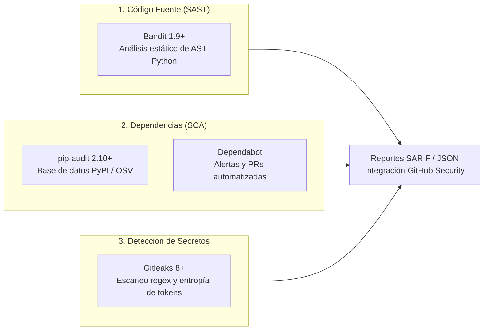

# Política de Seguridad, Severidad y Gestión de Vulnerabilidades

**Materia:** Programación Eficiente — Opción 6 (Universidad Blas Pascal, 2026)  
**Proyecto:** Optimizador de Inventario y Preparación de Pedidos en Escala Masiva  
**Equipo de Desarrollo:** Edgar Karpowicz, Gastón Molina, Tomás Molina  
**Documento Normativo:** Requisito 2 de `docs/Parcial-3.docx`  

---

## 1. Introducción y Marco de Aplicación

La seguridad del software en sistemas de alto rendimiento y logística de almacenes es un requisito no funcional crítico. La presencia de dependencias desactualizadas, secretos expuestos o patrones inseguros de codificación compromete la integridad del inventario, la confiabilidad de los pedidos y la estabilidad del entorno de ejecución.

Este documento establece la **política oficial de seguridad, clasificación por severidad, condiciones de bloqueo en CI/CD y tratamiento de falsos positivos** aplicada sobre el código fuente, dependencias y repositorio del proyecto.

---

## 2. Pilares del Análisis de Seguridad

El sistema implementa tres capas complementarias de análisis automatizado:



1. **Análisis Estático de Código Fuente (SAST):** Con **Bandit**, evaluando llamadas inseguras, inyecciones, deserialización no confiable y debilidades criptográficas en el árbol sintáctico (`src/`).
2. **Análisis de Dependencias de Terceros (SCA):** Con **pip-audit** y **Dependabot**, contrastando los paquetes declarados en `requirements.txt` y `requirements-dev.txt` contra las bases de datos de vulnerabilidades conocidas (CVE, GitHub Advisory Database y OSV de Google).
3. **Detección Preventiva de Secretos y Credenciales:** Con **Gitleaks**, previniendo que tokens de API, claves privadas o cadenas de conexión se filtren en el historial de commits o en el árbol de trabajo.

---

## 3. Matriz de Clasificación por Severidad y Política de Bloqueo

En estricta conformidad con el enunciado de la cátedra, **no toda alerta produce automáticamente un rechazo ciego**; se define una **política de bloqueo graduada y verificable** en base al estándar CVSS (*Common Vulnerability Scoring System*):

| Nivel de Severidad | Criterio CVSS | Ejemplos Representativos | Acción en Pipeline de CI | Plazo de Remediación |
|:---:|:---:|---|:---:|:---:|
| **Crítica (Critical)** | $9.0 - 10.0$ | Ejecución remota de código (RCE), deserialización arbitraria, escalación de privilegios, credenciales activas expuestas. | 🛑 **Bloqueo Inmediato (Fallo del Build)** | Inmediata (Hotfix prioritario). La PR no puede mergearse. |
| **Alta (High)** | $7.0 - 8.9$ | Vulnerabilidad explotable conocida en dependencia activa, inyección de comandos, omisión de controles de acceso. | 🛑 **Bloqueo Inmediato (Fallo del Build)** | Máximo 48 horas tras detección. |
| **Media (Medium)** | $4.0 - 6.9$ | Denegación de servicio acotada, configuraciones subóptimas, dependencias en sub-árboles dev no expuestas a producción. | ⚠️ **Advertencia (Warning)** | Dentro del ciclo de entrega en curso. Requiere revisión documentada. |
| **Baja / Informativa (Low/Info)** | $0.1 - 3.9$ | Advertencias de estilo seguro, uso de generadores pseudoaleatorios para propósitos no criptográficos, documentación. | ℹ️ **Registro Informativo (Pasa CI)** | Revisión durante tareas de refactorización o mantenimiento periódico. |

---

## 4. Generación de Reportes Estándar (Consola, JSON y SARIF)

Para asegurar la trazabilidad y la integración con las herramientas nativas de GitHub:

1. **Reportes Legibles en Terminal:** Se imprimen en la salida estándar de los jobs de CI para diagnóstico rápido por parte del desarrollador.
2. **Reportes Estructurados JSON:** Almacenados como artefactos descargables de la corrida del workflow (`bandit-report.json`, `pip-audit-report.json`).
3. **Reportes Estándar SARIF (*Static Analysis Results Interchange Format*):** Exportados e importados directamente a la pestaña **Security → Code scanning alerts** del repositorio en GitHub mediante `github/codeql-action/upload-sarif`.

### Comandos Canónicos de Generación:

```bash
# 1. Bandit SAST (Consola y SARIF)
bandit -r src/ -f sarif -o bandit-report.sarif
bandit -r src/ -f json -o bandit-report.json

# 2. pip-audit SCA (Consola y JSON)
pip-audit -r requirements.txt -r requirements-dev.txt --format json -o pip-audit-report.json
pip-audit -r requirements.txt -r requirements-dev.txt

# 3. Gitleaks (Detección de Secretos en SARIF)
gitleaks detect --source . --verbose --report-format sarif --report-path gitleaks-report.sarif
```

---

## 5. Protocolo de Tratamiento de Falsos Positivos y Excepciones Justificadas

Cuando un analizador estático o detector de vulnerabilidades emite una alerta sobre un fragmento de código que no representa un riesgo real, se sigue un procedimiento estricto:

### 5.1. Reglas de Exclusión
1. **Prohibido Desactivar Reglas Globalmente:** Nunca se eliminará una regla de seguridad de forma general en la configuración de la herramienta si solo aplica a una línea o archivo específico.
2. **Aislamiento en Código:** Se utiliza el comentario canónico inline `# nosec: <ID_REGLA>` directamente en la línea afectada.
3. **Documentación Obligatoria:** Cada uso de `# nosec` o entrada en la lista blanca de `.gitleaks.toml` debe estar justificado en este registro.

### 5.2. Registro Oficial de Excepciones y Falsos Positivos Aprobados

| ID Regla / Herramienta | Archivo / Ubicación | Código Afectado | Justificación Técnica de Aprobación |
|---|---|---|---|
| **Bandit `B311`** | `src/datos/generador_archivos.py:45` | `rnd = random.Random(seed)` | **Generación Sintética Determinista:** Se utiliza `random.Random` con semilla fija (`seed=42`) exclusivamente para generar datasets sintéticos reproducibles de productos en benchmarks. No se utiliza para tokens de sesión, hashing de contraseñas ni propósitos criptográficos. Marcado con `# nosec: B311`. |
| **Bandit `B311`** | `src/datos/generador_archivos.py:69` | `rnd = random.Random(seed + 100)` | **Generación Sintética Determinista:** Generación de pedidos sintéticos de prueba con semilla fija para tests de rendimiento. Mismo caso no criptográfico que el anterior. Marcado con `# nosec: B311`. |
| **Gitleaks `generic-api-key`** | `tests/observabilidad/test_apm.py` | `secret_token = "dummy_token"` | **Fixtures de Pruebas Unitarias:** Cadenas de prueba simuladas utilizadas para verificar que el cliente de Elastic APM no levante errores ante credenciales sintéticas. Excluido mediante `.gitleaks.toml`. |

---

## 6. Procedimiento ante Detección de una Vulnerabilidad Real

Si un escaneo de CI o una alerta de Dependabot detecta una vulnerabilidad en una dependencia o en el código fuente:

1. **Aislamiento:** El CI falla automáticamente si la vulnerabilidad es de severidad **Crítica** o **Alta**, impidiendo el merge a `dev` o `main`.
2. **Análisis de Impacto:** Se determina si la función o módulo vulnerable de la biblioteca externa es alcanzable desde la lógica del motor o de la interfaz gráfica.
3. **Actualización Inmediata:** Si existe versión corregida (*Fix Version*):
   - Se actualiza la versión mínima en `pyproject.toml` y `requirements.txt` / `requirements-dev.txt`.
   - Se ejecuta `uv sync` para regenerar `uv.lock`.
   - Se ejecutan las 193 pruebas automatizadas para garantizar compatibilidad retroactiva.
4. **Mitigación Temporal:** Si no existe versión corregida inmediata, se aísla el método afectado o se aplica un filtro de entrada/sanitización en el cargador hasta que el mantenedor publique el parche.
5. **Trazabilidad:** Se registra el CVE, la PR de solución y el commit de fix en las notas de versión del proyecto.
