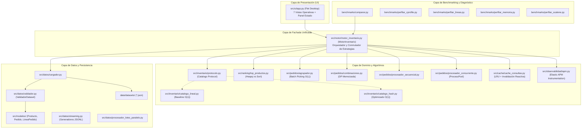

# 2. Arquitectura del Sistema

## 2.1. Visión General y Principios de Diseño

El sistema está diseñado bajo una arquitectura en capas desacopladas, siguiendo los principios de alta cohesión y bajo acoplamiento. La capa de dominio algorítmico y lógica de negocio es completamente independiente de la interfaz gráfica de usuario (**Flet**), de los generadores de datos y de las herramientas de medición e instrumentación.

### Principio Fundamental de Dualidad
Tanto la aplicación de escritorio como los scripts de benchmarking y las pruebas automatizadas consumen **exactamente la misma interfaz pública unificada** expuesta por la fachada `MotorInventario`. Esto permite conmutar la estrategia algorítmica (`estrategia="baseline"` frente a `estrategia="optimizado"`) con garantía estricta de reproducibilidad y equivalencia de resultados.

---

## 2.2. Diagrama de Componentes

---

## 2.3. Módulos y Responsabilidades del Sistema

El código fuente en `src/` se estructura en 9 subsistemas de alta cohesión:

| Módulo / Paquete | Responsabilidad Principal | Patrón / Técnica Aplicada |
|---|---|---|
| **`src/modelos/`** | Entidades inmutables de dominio (`Producto`, `Pedido`, `LineaPedido`, `ResumenProcesamiento`). | Dataclasses validadas con slots inmutables. |
| **`src/inventario/`** | Almacenamiento de catálogo, indexación hash y búsqueda secuencial baseline. | `CatalogoProtocol` (`typing.Protocol`), índice invertido de texto y hash map $O(1)$. |
| **`src/pedidos/`** | Preparación, validación, evaluación de factibilidad, batch picking y combinaciones sustitutas. | Separación de evaluación y asignación; Programación Dinámica (Knapsack variant) con memoización. |
| **`src/ranking/`** | Extracción de los $k$ ítems con mayor frecuencia agregada. | Min-Heap acotado (`heapq.nlargest`) en $O(n \log k)$ vs ordenamiento completo $O(n \log n)$. |
| **`src/cache/`** | Fachada de consultas frecuentes en memoria con capacidad acotada y desalojo. | Caché LRU (128 slots) basada en `OrderedDict` con **invalidación reactiva atómica** ante mutaciones. |
| **`src/datos/`** | Carga, validación estricta, lectura lazy en streaming, buffering y procesamiento paralelo en lotes. | Generadores de memoria $O(1)$, buffers de disco (`open(buffering=...)`), deserialización tipada. |
| **`src/observabilidad/`** | Captura de métricas transaccionales, spans y errores para Elastic APM. | Decoradores `@medir`, contextmanagers de spans y fallback seguro desacoplado. |
| **`src/motor/`** | Fachada orquestadora unificada que expone la API del sistema y conmuta estrategias. | Patrón Fachada (*Facade*) y Estrategia (*Strategy*). |
| **`src/ui/`** | Interfaz gráfica interactiva multiplataforma de escritorio. | **Flet** (arquitectura declarativa sobre Flutter Engine), tema accesible con alto contraste. |
