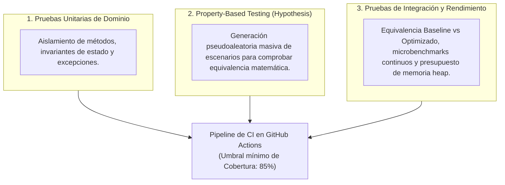

# 6. Estrategia de Pruebas y Aseguramiento de la Calidad

## 6.1. Filosofía de Pruebas

El sistema cuenta con una **red de seguridad automatizada de 198 pruebas**, organizada modularmente por paquetes de dominio bajo el directorio `tests/`. La estrategia combina tres niveles complementarios de verificación:



---

## 6.2. Organización Modular de la Suite de Pruebas

| Subdirectorio de Pruebas | Casos Cubiertos | Propósito Principal |
|---|:---:|---|
| **`tests/modelos/`** | 9 | Validación de constructores, inmutabilidad, cálculo de totales e integridad de dataclasses. |
| **`tests/inventario/`** | 13 | Búsqueda por ID, coincidencia de texto, índice por categoría y cumplimiento de `CatalogoProtocol`. |
| **`tests/pedidos/`** | 20 | Batch picking consolidado, evaluación de factibilidad, combinaciones DP y procesadores concurrentes/secuenciales. |
| **`tests/ranking/`** | 4 | Selección de Top-N con montículos binarios y ordenamiento contra lista de frecuencias. |
| **`tests/cache/`** | 3 | Desalojo LRU (capacidad máxima), hit ratio e invalidación reactiva atómica por mutaciones. |
| **`tests/datos/`** | 38 | Deserialización JSON, streaming JSON Lines, buffering, validador de integridad y procesamiento en lotes. |
| **`tests/observabilidad/`** | 11 | Instrumentación de Elastic APM, decoradores `@medir`, spans internos y fallback ante ausencia de servidor. |
| **`tests/motor/`** | 10 | Fachada unificada `MotorInventario`, conmutación en caliente de estrategias baseline/optimizado. |
| **`tests/ui/`** | 36 | Inicialización de vistas Flet, panel de estado reactivo, componentes accesibles y tokens de diseño. |
| **`tests/integracion/`** | 37 | Equivalencia baseline vs optimizado, artefactos generados, microbenchmarks y presupuesto de memoria heap. |
| **`tests/automations/`** | 17 | Motor de análisis AST de complejidad y generador de informes de hotspots. |

---

## 6.3. Cobertura de Código y Umbrales Estrictos

La suite se ejecuta en cada commit utilizando `pytest-cov`, configurada con soporte para medir también los procesos hijos del `ProcessPoolExecutor`:

```ini
[tool.coverage.run]
source = ["src"]
concurrency = ["multiprocessing", "thread"]
parallel = true
```

- **Cobertura Global en `src/`:** **90%** (2.523 sentencias evaluadas, 258 sin cubrir).
- **Umbral de Bloqueo en CI:** **85%** (`--cov-fail-under=85`). Si una modificación reduce la cobertura por debajo de este valor, el pipeline rechaza el merge automáticamente.

---

## 6.4. Pruebas Basadas en Propiedades (*Property-Based Testing*)

Mediante la biblioteca **Hypothesis** (`tests/integracion/test_propiedades_hypothesis.py`), se evalúa la equivalencia funcional entre la versión baseline y la versión optimizada sobre miles de entradas generadas dinámicamente:
- **Equivalencia de Catálogo:** Para cualquier conjunto aleatorio de productos y claves de consulta, `catalogo_hash.buscar_por_id(k)` devuelve exactamente el mismo resultado que `catalogo_lineal.buscar_por_id(k)`.
- **Equivalencia de Picking:** La consolidación de líneas de demanda aleatorias produce idénticas cantidades acumuladas por SKU.
- **Equivalencia de Ranking:** El Min-Heap Top-N retorna el mismo orden y frecuencia que el ordenamiento integral.
