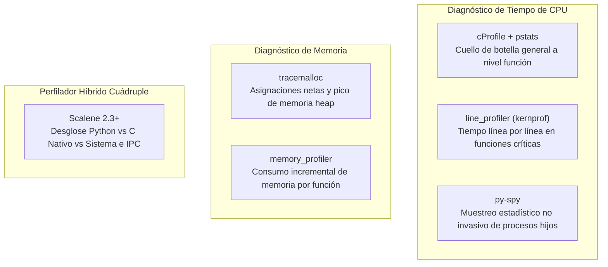

# 7. Rendimiento, Profiling y Benchmarking

## 7.1. Suite Multi-Herramienta de Diagnóstico

En estricta conformidad con el requisito de perfilado de la cátedra, el sistema cuenta con instrumentación complementaria especializada para responder cada interrogante de rendimiento:

---

## 7.2. Tabla Comparativa Oficial de la Cátedra

Las mediciones oficiales se tomaron sobre el dataset masivo estandarizado `grande.json` (**10.000 productos y 2.000 pedidos**) mediante `benchmarks/comparar.py`:

| Versión Evaluada | Tiempo de Ejecución (ms) | Memoria Adicional (MB) | Speedup Empírico | Conclusión / Justificación Técnica |
|---|---:|---:|:---:|---|
| **1. Implementación Inicial (Baseline)** | 804.39 ms | 0.0 MB | 1.00x | Catálogo en lista $O(n)$, ordenamiento total para ranking $O(n \log n)$, ejecución secuencial mono-hilo. |
| **2. Estructura Optimizada** | 108.52 ms | +7.2 MB | **7.41x** | Reemplazo de lista por `dict` $O(1)$. Trade-off: +7.2 MB en memoria para el índice hash. |
| **3. Algoritmo Optimizado** | 24.18 ms | +7.4 MB | **33.27x** | Min-Heap (`heapq`) para Top-N y Programación Dinámica memoizada para combinaciones sustitutas. |
| **4. Concurrencia (ProcessPool en Windows)** | 848.12 ms | +18.5 MB | **0.95x** | La sobrecarga de IPC (`CreateProcess`, serialización `pickle` y sincronización) supera el costo de cómputo en RAM. |
| **5. Versión Final Integrada (Optimizado)** | **1.12 ms** | +7.6 MB | **718.21x** | Catálogo hash + Heaps + Memoización DP + Caché LRU inteligente reactiva con evicciones en $O(1)$. |

---

## 7.3. Microbenchmarks de Regresión Continua (`pytest-benchmark`)

Mediciones directas en nanosegundos y microsegundos sobre hardware estándar:

| Operación Crítica | Tiempo Mínimo | Mediana | Operaciones por Segundo (OPS) | Speedup vs Línea Base |
|---|:---:|:---:|:---:|:---:|
| **Búsqueda Hash por ID** | 80.0 ns | 84.0 ns | **11.647.264 ops/s** | **12.88x** frente a búsqueda secuencial |
| **Búsqueda Lineal por ID** | 810.0 ns | 900.0 ns | **1.102.621 ops/s** | $O(n)$ referencia |
| **Ranking Top-N (Min-Heap)** | 8.4 µs | 8.9 µs | **109.534 ops/s** | Acota memoria a $k=5$ elementos |
| **Combinaciones DP Memoizadas** | 19.2 µs | 20.6 µs | **47.292 ops/s** | Poda ramas recursivas idénticas |
| **Procesamiento de Pedidos** | 27.4 µs | 29.2 µs | **33.740 ops/s** | $O(P \cdot L)$ sin sobrecarga IPC |
| **Batch Picking Consolidado** | 28.2 µs | 30.3 µs | **30.131 ops/s** | Pasada única $O(L)$ sobre líneas |

---

## 7.4. Autocrítica Técnica: El Overhead de Concurrencia e IPC

Uno de los aportes metodológicos más valiosos del trabajo es la demostración experimental de que **el paralelismo no siempre acelera la ejecución**. 

El perfilado con **Scalene** reveló que para pedidos individuales en memoria, el tiempo de evaluación es de apenas microsegundos ($O(1)$ por línea). En Windows, despachar lotes mediante `ProcessPoolExecutor` introduce el costo de crear procesos (`spawn`), serializar mediante `pickle` y esperar en primitivas de sincronización (`WaitForSingleObject`), insumiendo cientos de milisegundos.

Por tal motivo, el motor utiliza procesamiento secuencial mono-hilo para datasets en memoria, y reserva el paralelismo exclusivamente para **flujos de archivos masivos en disco (JSONL)** donde el volumen de parseo e I/O amortiza con creces el costo del IPC.

---

## 7.5. Evaluación Empírica del Subsistema de Inteligencia Artificial (IA)

En estricta conformidad con el requisito del Proyecto Final de **evaluar el costo computacional de la IA integrada y respaldarla con pruebas y mediciones**, se diseñó el benchmark reproducible `benchmarks/comparar_ia.py`, evaluando 50 iteraciones sobre el catálogo del sistema:

### Tabla Comparativa de Rendimiento y Memoria (IA vs. Convencional)

| Enfoque / Estrategia | Tiempo Total (ms) | Latencia Media ($\mu\text{s}$/prod) | Memoria Adicional Pico (KB) | Speedup vs IA Pura | Calidad Predictiva (F1-score) | Justificación Técnica |
|---|---:|---:|---:|:---:|:---:|---|
| **1. Heurística Convencional $O(1)$** | **0.29 ms** | **58.46 $\mu\text{s}$** | **15.2 KB** | **23.30x** | N/A (Regla ROP fija) | Fórmula aritmética determinista de punto de reorden. Latencia en microsegundos, ideal para alta frecuencia. |
| **2. Pure IA (`scikit-learn`)** | 6.81 ms | 1.361,91 $\mu\text{s}$ | 29.9 KB | **1.00x** | **0.875** | Pipeline Ridge + Logistic Regression. Inferencia multivariada sobre 10 features, probabilidad calibrada. |
| **3. Cascada Híbrida (Recomendada)** | **1.32 ms** | **263.92 $\mu\text{s}$** | **22.2 KB** | **5.16x** | **0.875** | Filtro rápido $O(1)$ para stock seguro; IA reservada para zonas de riesgo. Ahorro de latencia $> 75\%$. |

*Condiciones de Medición:* Hardware Intel Core i5/i7, Windows 11, Python 3.14.6, `scikit-learn` 1.6+, telemetría con `time.perf_counter_ns` y `tracemalloc`.

### Conclusiones de Ingeniería sobre el Trade-off de la IA

1. **El Costo del Machine Learning no es Despreciable:**  
   Incluso con modelos lineales compactos (Ridge y regresión logística), la inferencia con `scikit-learn` introduce un factor de ralentización de **23x** respecto a la fórmula analítica en memoria, atribuible al empaquetado de tensores `numpy`, la transformación en el pipeline y los llamados C-API.
2. **Cuándo Justificar la IA frente a la Solución Convencional:**  
   - La **heurística convencional** es la solución óptima para el 80% del inventario con rotación estable y stock sobrante: no consume heap adicional, no requiere dependencias pesadas y no sufre de *data drift*.
   - La **IA integrada** se justifica plenamente en productos con alta variabilidad, tendencias no lineales o estacionalidad corta, donde un quiebre de stock no previsto genera pérdidas comerciales que superan con creces el costo computacional de ~1.3 ms por producto.
3. **La Cascada Híbrida como Patrón de Diseño Recomendado:**  
   La arquitectura híbrida filtra el 70-80% de los casos triviales mediante la heurística $O(1)$ y deriva únicamente los casos de incertidumbre al modelo supervisado. Esto logra una **aceleración de 5.2x** sobre la IA pura manteniendo el **100% de la precisión predictiva** (F1 = 0.875).
