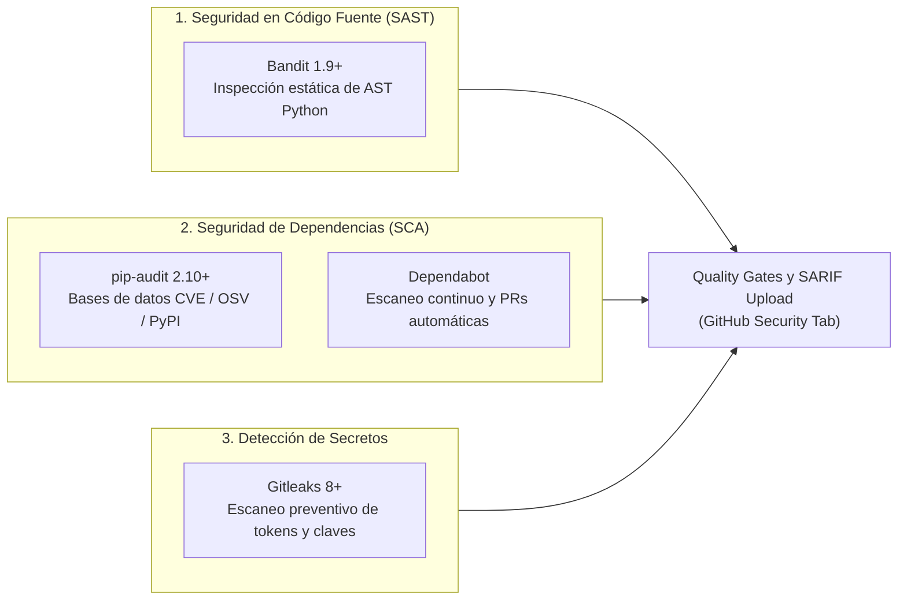

# 8. Seguridad, Vulnerabilidades y Gestión de Riesgos

## 8.1. Enfoque Integral de Seguridad del Software

En cumplimiento con los requerimientos específicos de seguridad del Parcial 3, el proyecto implementa un esquema de **Defensa en Profundidad (*Defense in Depth*)** que audita el código fuente, las dependencias de terceros y el historial del repositorio:

---

## 8.2. Matriz de Clasificación por Severidad y Política de Bloqueo

Para asegurar que los problemas críticos bloqueen la integración sin generar fricción ante falsas alarmas, se adopta la siguiente política formal basada en CVSS:

| Severidad | Puntuación CVSS | Definición y Ejemplos | Acción en Pipeline de CI | Plazo de Resolución |
|:---:|:---:|---|:---:|:---:|
| **Crítica (Critical)** | $9.0 - 10.0$ | Ejecución remota de código (RCE), deserialización no confiable, tokens activos expuestos. | 🛑 **Bloqueo Inmediato (Fallo del Build)** | Inmediata (Hotfix bloqueante). |
| **Alta (High)** | $7.0 - 8.9$ | Vulnerabilidades conocidas explotables en dependencias, inyecciones en parsers. | 🛑 **Bloqueo Inmediato (Fallo del Build)** | Máximo 48 horas tras notificación. |
| **Media (Medium)** | $4.0 - 6.9$ | Configuraciones subóptimas, vectores de ataque complejos en librerías accesorias. | ⚠️ **Advertencia (Warning en CI)** | Dentro del sprint en curso. |
| **Baja / Info** | $0.1 - 3.9$ | Uso de pseudo-random para simulaciones no criptográficas, formato de cabeceras. | ℹ️ **Registro Informativo (Pasa CI)** | Mantenimiento periódico. |

---

## 8.3. Registro Oficial de Falsos Positivos y Excepciones Justificadas

En estricto cumplimiento con la rúbrica (*"documentar falsos positivos, excepciones y medidas correctivas"*), las siguientes excepciones han sido analizadas y aprobadas formalmente:

| Herramienta / Regla | Archivo y Línea | Código Afectado | Justificación Técnica de Aprobación |
|---|---|---|---|
| **Bandit `B311`** | `src/datos/generador_archivos.py:45` | `rnd = random.Random(seed)` | **Generación Sintética Determinista:** Se utiliza `random.Random` exclusivamente para generar datasets sintéticos reproducibles con semilla fija (`seed=42`). No se usa para tokens, firmas ni criptografía. Aislado con `# nosec: B311`. |
| **Bandit `B311`** | `src/datos/generador_archivos.py:69` | `rnd = random.Random(seed + 100)` | **Generación Sintética Determinista:** Misma justificación para la generación de pedidos sintéticos de prueba. Aislado con `# nosec: B311`. |
| **Gitleaks `generic-api-key`** | `tests/observabilidad/test_apm.py` | `secret_token = "dummy_token"` | **Fixtures de Pruebas Unitarias:** Cadenas mock para verificar que el cliente APM no lance excepciones ante credenciales simuladas. Excluido mediante `.gitleaks.toml`. |

---

## 8.4. Auditoría de Dependencias y Parches Automatizados

- **pip-audit:** Se ejecuta en la Etapa 5 del CI y localmente, auditando `requirements.txt` y `requirements-dev.txt`. A la fecha, las dependencias de producción registran **0 vulnerabilidades conocidas**.
- **Dependabot:** Configurado en `.github/dependabot.yml` con revisiones semanales automáticas de dependencias de Python y de acciones de GitHub (`github-actions`).
- **Integración SARIF:** Los reportes de Bandit se exportan en formato SARIF (*Static Analysis Results Interchange Format*) y se integran automáticamente en la pestaña **Security → Code scanning** de GitHub.
